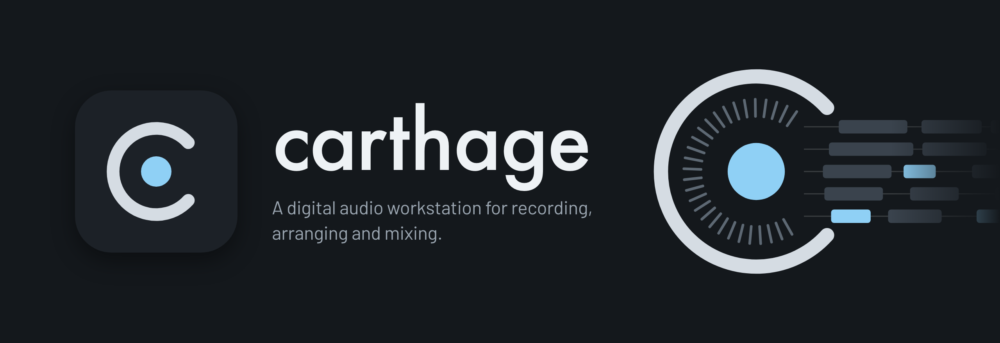
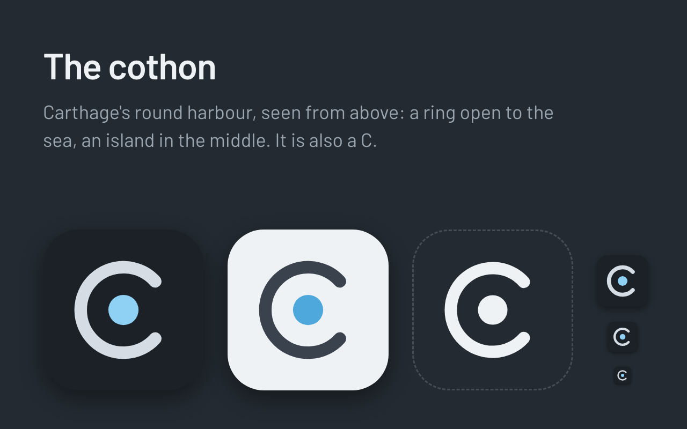
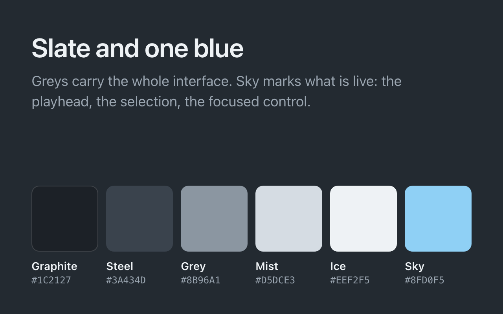
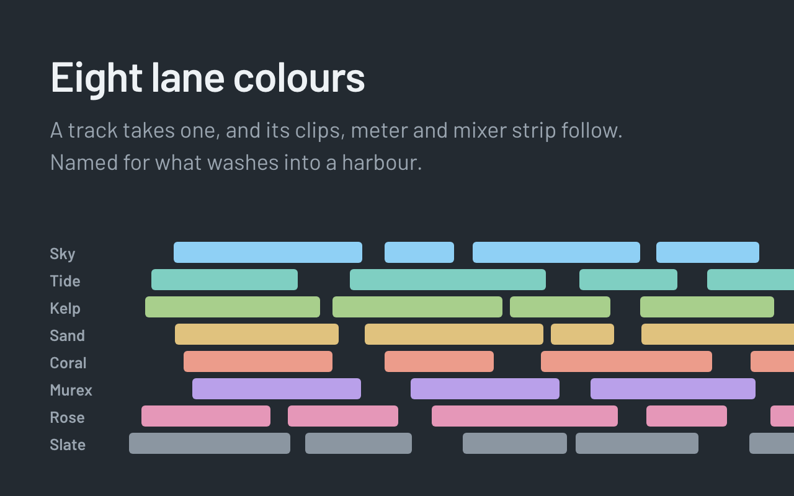
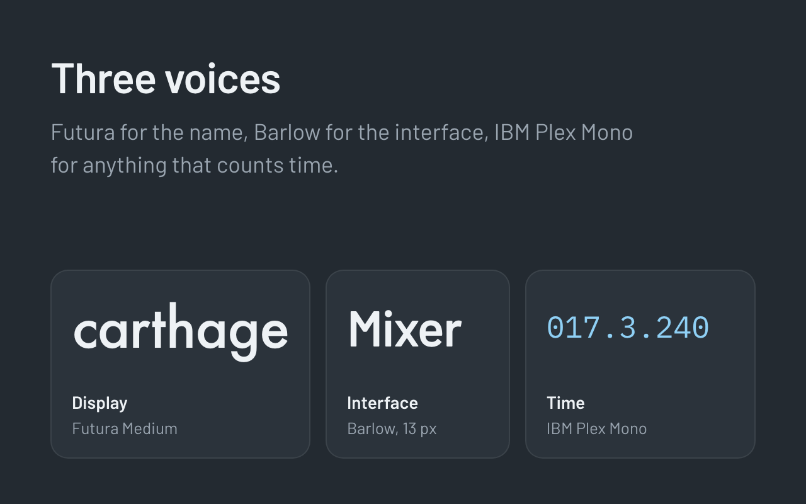

<div align="center">

<picture>
  <source media="(prefers-color-scheme: light)" srcset="docs/art/banner-light.png" />
  
</picture>

<br/><br/>

[](LICENSE)


Carthage is a native digital audio workstation for macOS and Windows, in its first days.<br/>
Track a guitar through your amp sims, build the song on a timeline, write parts in a piano roll, mix it down.<br/>
It hosts the plugins you already own and ships none of its own.

</div>

<br/>

## Where it stands

**There is no application to run yet.** The name, the mark, the look and the plan are settled; the
engine and the interface come next. This repository holds the foundation they are built on:

- the **mark** and app icon ([design/icon](design/icon), [design/logo](design/logo)),
- the **theme** as design tokens ([design/tokens.css](design/tokens.css), [design/README.md](design/README.md)),
- the **artwork** on this page and the script that renders it ([design/banners](design/banners)),
- the **plan**: what Carthage is, how it will be built and in what order ([docs](docs)).

## What it will be

Carthage is being built in C++ on [JUCE](https://juce.com) and
[Tracktion Engine](https://github.com/Tracktion/tracktion_engine), for Apple Silicon Macs first and
Windows second. The aim is a DAW that is faster, smoother and more reliable than the big ones on an ARM
Mac, by doing less: no bundled instruments or effects, no gimmicks.

- **Your plugins.** AU and VST3 hosting, scanned in a separate process so a bad plugin can't take the app down.
- **Free routing.** Timeline lanes hold any clips; every clip, instrument and input goes to whichever mixer channel you choose.
- **Fast hands.** Single-letter tools you can hold to switch, one grid and snap system across the timeline and piano roll, every shortcut rebindable.
- **Live guitar.** Low-latency monitoring through amp sims, with the round-trip latency measured and shown.
- **Quiet updates.** The app updates itself on quit and never interrupts a take.

None of this is built yet. Progress is tracked phase by phase in [docs/ROADMAP.md](docs/ROADMAP.md).

| Document | What it covers |
| --- | --- |
| [docs/BRIEF.md](docs/BRIEF.md) | The full specification |
| [docs/ROADMAP.md](docs/ROADMAP.md) | The seven build phases and their status |
| [docs/ARCHITECTURE.md](docs/ARCHITECTURE.md) | Layers, threads, the model, plugin hosting |
| [docs/DECISIONS.md](docs/DECISIONS.md) | What is fixed, what was decided, what is open |
| [docs/TESTING.md](docs/TESTING.md) | How changes are verified and measured |
| [docs/RELEASING.md](docs/RELEASING.md) | Versions, releases and in-app updates |
| [AGENTS.md](AGENTS.md) · [CONTRIBUTING.md](CONTRIBUTING.md) | Working rules for agents and people |

## Look and feel

Carthage is named for the city whose harbour, the *cothon*, was a ring of water around an island, with
a single channel out to sea. That plan is the mark, and it is the shape of the app: everything is kept
in one place around a centre, and tracks leave through one channel as a timeline.

<table>
  <tr>
    <td width="50%"><picture><source media="(prefers-color-scheme: light)" srcset="docs/art/card-mark-light.png" /></picture></td>
    <td width="50%"><picture><source media="(prefers-color-scheme: light)" srcset="docs/art/card-palette-light.png" /></picture></td>
  </tr>
  <tr>
    <td width="50%"><picture><source media="(prefers-color-scheme: light)" srcset="docs/art/card-lanes-light.png" /></picture></td>
    <td width="50%"><picture><source media="(prefers-color-scheme: light)" srcset="docs/art/card-type-light.png" /></picture></td>
  </tr>
</table>

| | |
| --- | --- |
| **Surfaces** | Flat graphite and slate greys. The app is dark only in v1. No glass, gradients or glows. |
| **Accent** | One blue, *sky*. It marks what is live: the playhead, the selection, the focused control. |
| **Tracks** | Eight lane colours. A track takes one, and its clips, meter and mixer strip follow. |
| **Signal** | Green, amber and red appear only on meters, record arm and warnings. |
| **Type** | The system typeface at 13 px; fixed-width figures for timecode, bars and decibels; Futura for the wordmark. |

The full guide is in [design/README.md](design/README.md).

## Repository layout

```
design/
  tokens.css        colours, type, shape, spacing and motion
  README.md         the theme guide: what each token is for, and the rules
  icon/             app icon master (SVG) and 1024 px render
  logo/             the mark on dark, on light, in one colour, and a favicon
  banners/          art.html + render.sh, the source of everything in docs/art
docs/
  BRIEF.md  DECISIONS.md  ROADMAP.md  ARCHITECTURE.md  TESTING.md  RELEASING.md
  art/              rendered banners, cards and the social preview
AGENTS.md           working rules for coding agents (CLAUDE.md points to it)
CONTRIBUTING.md  CHANGELOG.md  SECURITY.md
```

## Regenerating the artwork

The images on this page are rendered from `design/banners/art.html` with headless Google Chrome:

```bash
design/banners/render.sh
```

It reads its colours from `design/tokens.css`, so a change to a token shows up in the next render.
`docs/art/social-preview.png` is the image for the repository's social preview (Settings → General).

## Contributing

See [CONTRIBUTING.md](CONTRIBUTING.md). Security problems: [SECURITY.md](SECURITY.md).

## License

Carthage is free software under the [GNU Affero General Public License v3.0](LICENSE) or later. It is
built on JUCE (AGPLv3) and Tracktion Engine (GPLv3-or-later); see [docs/DECISIONS.md](docs/DECISIONS.md), F16.
